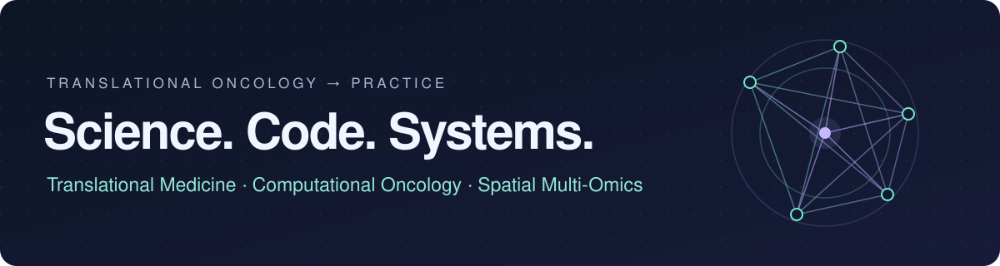

<div align="center">



# Luca Celebrano

**Medical Student / MD Candidate** · Università degli Studi di Napoli Federico II  
**Bioinformatics thesis student** · TIGEM  
Computational oncology · Spatial multi-omics · Biophysical reaction-diffusion modeling · Digital pathology AI

[](https://orcid.org/0009-0007-0931-3555)
[](https://www.linkedin.com/in/luca-celebrano/)
[](https://www.researchsquare.com/)
[](https://huggingface.co/spatial-continuum-lab)
[](https://lukecele-research.vercel.app/)

</div>

## About

I am a medical student and bioinformatics thesis student working at the intersection of **clinical medicine, computational biology and reproducible research software**. My current program studies non-genetic therapy resistance, spatial drug transport, tumor microenvironments and low-cost diagnostic AI in solid tumors.

I build small, auditable tools that can be inspected, tested and reused: Python CLIs, spatial-omics assays, Nextflow modules, package recipes, interactive research portals and educational clinical software.

**Current focus — November 2026:** bioinformatics thesis work at TIGEM, computational oncology research, reproducible spatial-omics software and open-source scientific infrastructure.

🏰 **Personal research hub:** [Caverna di Luca](https://lukecele-research.vercel.app/) — portfolio, live demos and selected frames.

## Research & publications

### Main manuscript — *Scientific Reports*

**The Spatial-Genomic Oncology Continuum: A Biophysical Reaction-Diffusion Theory of Pharmacological Sanctuaries, the Post-ADAURA Cessation Dilemma, and the SG-ADAURA Clinical Trial Protocol**

Current status: **under consideration · editor assigned**.

- [Spatial Continuum Oncology repository](https://github.com/Lukecele/spatial-continuum-oncology)
- [Research Square preprint DOI](https://doi.org/10.21203/rs.3.rs-11530312/v1)
- [Zenodo master archive](https://doi.org/10.5281/zenodo.23754999)
- [Full manuscript PDF](https://github.com/Lukecele/spatial-continuum-oncology/raw/main/01_MANOSCRITTO_FINALE_CON_FIGURE.pdf)
- [Slides](https://lukecele.github.io/spatial-continuum-oncology/slides.html) · [Poster](https://lukecele.github.io/spatial-continuum-oncology/poster.html) · [Lay summary](https://lukecele.github.io/spatial-continuum-oncology/#gist)

### Translational preprint — *Research Square*

**A Biophysical Reaction-Diffusion Framework for Conditional Sub-Threshold Compartments in Solid Tumors: An Exploratory Translational Model**

This companion translational work is already **posted and citable** as a preprint.

- [Final translational repository](https://github.com/Lukecele/spatial-continuum-translational)
- [Research Square DOI: 10.21203/rs.3.rs-11633521/v1](https://doi.org/10.21203/rs.3.rs-11633521/v1)
- [Zenodo version DOI: 10.5281/zenodo.23963563](https://doi.org/10.5281/zenodo.23963563)

## Methods & stack

`Python` · `NumPy` · `SciPy` · `pandas` · `scikit-learn` · `PyTorch` · `Nextflow DSL2` · `nf-core` · `Conda/Bioconda` · `Docker/Singularity` · `TypeScript` · `React` · `Three.js`

## Featured repositories

These are the three projects that best represent my current research and software work:

1. 👑 [**Spatial Continuum Oncology**](https://github.com/Lukecele/spatial-continuum-oncology) — reaction-diffusion transport, perivascular pharmacological sanctuaries, bedside CRI and the 3D digital twin.  
   [Live portal](https://lukecele.github.io/spatial-continuum-oncology/) · [60 FPS simulator](https://lukecele.github.io/spatial-continuum-oncology/simulator.html) · [Hugging Face 3D Space](https://huggingface.co/spaces/spatial-continuum-lab/tumor-cord-sanctuary-3d)
2. 🧬 [**Spatial Continuum Translational**](https://github.com/Lukecele/spatial-continuum-translational) — evidence-linked translational extensions, study protocol and research-only audit tools.  
   [Research Square DOI](https://doi.org/10.21203/rs.3.rs-11633521/v1) · [Zenodo DOI](https://doi.org/10.5281/zenodo.23963563)
3. 🎲 [**InSituGame**](https://github.com/Lukecele/spatial-game-assay) — spatial evolutionary-game assay for subclonal payoff matrices and adaptive-therapy regimes.  
   [Bioconda](https://github.com/bioconda/bioconda-recipes/pull/70893) · [Live assay portal](https://lukecele.github.io/spatial-game-assay/) · [Zenodo DOI](https://doi.org/10.5281/zenodo.23585216)

## Further research systems

| Project | Focus | Access |
| :--- | :--- | :--- |
| 📐 [Spatial Oncology Master](https://github.com/Lukecele/spatial-oncology-master) | Cylindrical Bessel $K_0$ solver, pharmacological sanctuary modeling and MSKCC validation ($N=604$). | [Portal](https://lukecele.github.io/spatial-oncology-master/) · [GHCR](https://github.com/Lukecele/spatial-oncology-master/pkgs/container/spatial-oncology-master) |
| 👁️ [InSituVision-AI](https://github.com/Lukecele/spatial-he-vision-study4) | Low-cost Attention-MIL pathology AI for spatial vascular decoupling and relapse-risk research. | [Live portal](https://lukecele.github.io/spatial-he-vision-study4/) |
| 📊 [Massive Validation Study](https://github.com/Lukecele/spatial-massive-validation-study3) | Multi-cohort survival validation across 854 lung adenocarcinoma cases. | [Evidence module](https://lukecele.github.io/spatial-continuum-oncology/#evidence) |
| 🧭 [Spatial Architecture](https://github.com/Lukecele/spatial-architecture-osimertinib) | 10x Visium HD analysis of subcellular transport limits in EGFR-mutant NSCLC. | [Visium module](https://lukecele.github.io/spatial-continuum-oncology/#visium) |

## Reproducible software

Officially packaged tools and modules:

```bash
conda install -c bioconda spatial-continuum
conda install -c bioconda insitugame
conda install -c bioconda spatial-sanctuary
```

- [PyPI: spatial-continuum](https://pypi.org/project/spatial-continuum/)
- [bio.tools registry](https://bio.tools/spatial-continuum-oncology)
- [Bioconda: spatial-continuum](https://anaconda.org/bioconda/spatial-continuum)
- [Bioconda: insitugame](https://anaconda.org/bioconda/insitugame)
- [Bioconda: spatial-sanctuary](https://anaconda.org/bioconda/spatial-sanctuary)
- [Hugging Face research organization](https://huggingface.co/spatial-continuum-lab)

## Clinical education

### [MedTerminal Cardio-Toracico](https://github.com/Lukecele/cardio-thoracic-medterminal)

An interactive learning platform for medical students, built with React, TypeScript, Three.js and Tailwind CSS:

- 3D cardiac and thoracic anatomy;
- simulated ECG telemetry and acute STEMI/NSTEMI patterns;
- cardiac murmurs and respiratory sound library;
- case-based active recall and bedside calculators.

👉 [Open the live platform](https://cardio-thoracic-medterminal.vercel.app)

## Earlier work: financial engineering and DeFi

Before focusing on medicine and computational oncology, I worked on open-source financial and blockchain software through the **[Arbitrage Inception](https://github.com/arbincept)** organization.

- [Arb-Inc All-in-Dex](https://github.com/arbincept/Arb-Inc-All-in-Dex) — BSC DEX aggregation, cross-chain routing and limit orders.
- [Arbitrage Inception Earn](https://github.com/arbincept/arbitrage-inc-earn) — yield and lending vault integrations on BNB Chain.

This work remains part of my engineering background, alongside the current biomedical research program.

## Verified upstream contributions

Only merged contributions are listed here; open submissions remain tracked in their respective repositories.

### Computational biology and open science

- **Bioconda** — [spatial-continuum #70930](https://github.com/bioconda/bioconda-recipes/pull/70930), [insitugame #70893](https://github.com/bioconda/bioconda-recipes/pull/70893), [spatial-sanctuary #70840](https://github.com/bioconda/bioconda-recipes/pull/70840).
- **nf-core/modules** — [PostprocessGermlineCNVCalls #13080](https://github.com/nf-core/modules/pull/13080) and [ABRA2 #13039](https://github.com/nf-core/modules/pull/13039).
- **Awesome-AI4DigitalPathology** — [#28](https://github.com/lingxitong/Awesome-AI4DigitalPathology/pull/28), [#29](https://github.com/lingxitong/Awesome-AI4DigitalPathology/pull/29).
- **awesome-single-cell** — [#399](https://github.com/seandavi/awesome-single-cell/pull/399), [#404](https://github.com/seandavi/awesome-single-cell/pull/404).

### Software and developer infrastructure

- **Angular** — [DevTools signal inspection fix #70986](https://github.com/angular/angular/pull/70986).
- **viem** — [Plasma/Kortana network support #5108](https://github.com/wevm/viem/pull/5108), [#5136](https://github.com/wevm/viem/pull/5136).
- **Ethereum Lists** — [Sonic RPC additions #8730](https://github.com/ethereum-lists/chains/pull/8730).
- **DefiLlama** — [fee adapters and BSC telemetry #9838](https://github.com/DefiLlama/dimension-adapters/pull/9838), [#9453](https://github.com/DefiLlama/dimension-adapters/pull/9453).

## Contact and affiliations

- **Medical training:** Department of Clinical Medicine and Surgery, School of Medicine and Surgery, Università degli Studi di Napoli Federico II.
- **Bioinformatics thesis:** [TIGEM](https://www.tigem.it/).
- **Academic email:** [l.celebrano@studenti.unina.it](mailto:l.celebrano@studenti.unina.it)
- **Personal email:** [luca.celebrano1@gmail.com](mailto:luca.celebrano1@gmail.com)
- **ORCID:** [0009-0007-0931-3555](https://orcid.org/0009-0007-0931-3555)
- **LinkedIn:** [linkedin.com/in/luca-celebrano](https://www.linkedin.com/in/luca-celebrano/)
- **GitHub:** [@Lukecele](https://github.com/Lukecele)
- **Hugging Face:** [@spatial-continuum-lab](https://huggingface.co/spatial-continuum-lab)

<sub>Profile refreshed November 2026 · Research, software and open-source contributions are presented for scientific and educational use.</sub>
