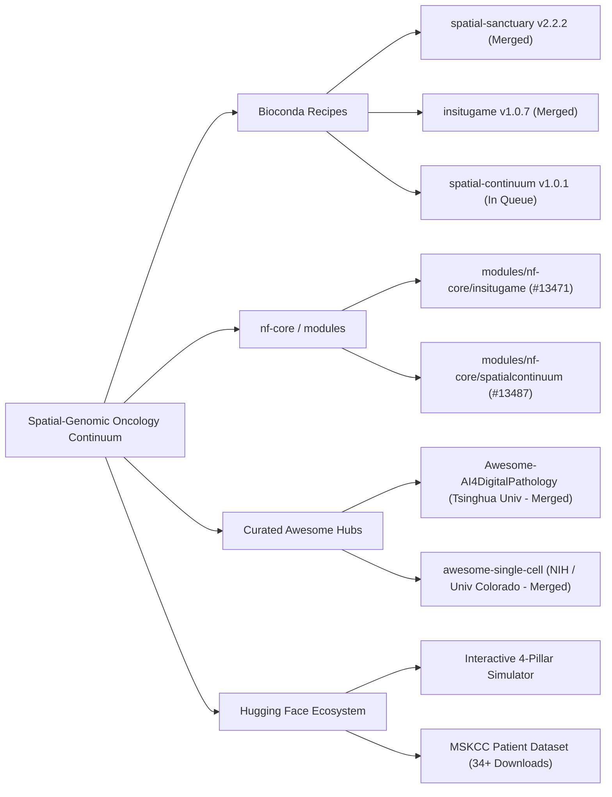

# Luca Celebrano

**Medical Student / MD Candidate** at [Università degli Studi di Napoli Federico II](https://www.unina.it/)  
Department of Clinical Medicine and Surgery, School of Medicine and Surgery · Naples, Italy  
[ORCID: 0009-0007-0931-3555](https://orcid.org/0009-0007-0931-3555) · [l.celebrano@studenti.unina.it](mailto:l.celebrano@studenti.unina.it)

**Computational Oncology · Biophysical Transport Theory · Spatial Multi-Omics · Digital Pathology AI**

 

[-00599c?style=flat-square&logo=medrxiv&logoColor=white)](https://submit.medrxiv.org)

[-10b981?style=flat-square&logo=github&logoColor=white)](https://github.com/lingxitong/Awesome-AI4DigitalPathology#computational-pathology-with-multi-omics)
[-10b981?style=flat-square&logo=github&logoColor=white)](https://github.com/seandavi/awesome-single-cell#spatial-transcriptomics)

[-blue?style=flat-square)](https://huggingface.co/datasets/Lucace/mskcc-lung-adenocarcinoma-spatial-cohort)

---

## 🔬 Scientific Research: Computational Oncology Program

Independent medical student translational research program investigating **non-genetic targeted therapy resistance, biophysical reaction-diffusion transport, and low-cost diagnostic AI** in *EGFR*-mutant lung adenocarcinoma (NSCLC). Affiliated with the Department of Clinical Medicine and Surgery, School of Medicine and Surgery, **Università degli Studi di Napoli Federico II**, Naples, Italy.

> [!IMPORTANT]
>
> ### 👑 [Grand Unified Framework: The Spatial-Genomic Oncology Continuum](https://github.com/Lukecele/spatial-continuum-oncology)
>
> **A Biophysical Reaction-Diffusion Theory of Pharmacological Sanctuaries, the Post-ADAURA Cessation Dilemma, and the Bedside Composite Resistance Index (CRI)**  
> *Target Journal: Nature Communications* | *Preprint DOI: [10.21203/rs.3.rs-11530312/v1](https://doi.org/10.21203/rs.3.rs-11530312/v1)* | *medRxiv MS ID: MEDRXIV/2026/366778* | *Zenodo: [10.5281/zenodo.23748047](https://doi.org/10.5281/zenodo.23748047)*  
>
> 1. **Biophysical Reaction-Diffusion Transport:** Cylindrical modified Bessel $K_0$ decay demonstrating that an outward microvascular cord develops a sub-therapeutic pharmacological sanctuary shell ($\Delta r = 34.11\,\mu\text{m}$, $31.3\%$ cord volume) between $r_{\text{crit}} = 165.89\,\mu\text{m}$ and the hypoxia/necrosis boundary $r_{\text{ox}} = 200.0\,\mu\text{m}$. Conversely, inward avascular nests maintain high drug penetrance (>90%), precluding small-molecule shelters.
> 2. **Universal Regrowth-Kinetics Lead-Time Identity:** Exact mathematical proof that the ctDNA molecular recurrence lead time ($\Delta t = T_s \log_2(100) = 5.46\,\text{months}$ for doubling time $T_s = 25\,\text{days}$) is an invariant kinetic identity of exponential volume expansion from $10^7$ to $10^9$ cells, resolving the post-ADAURA recurrence surge without invoking de novo secondary mutations.
> 3. **Translational Bedside CRI & SG-ADAURA Protocol:** Formulation of the Composite Resistance Index ($\text{CRI} = 0.40 \cdot \Delta r_{\text{norm}} + 0.35 \cdot \text{VDI}_{\text{norm}} + 0.25 \cdot \text{HR}_{\text{hist}}$) and the prospective Phase III SG-ADAURA trial allocation protocol (Arms A, B1/B2/B3, C).
> 4. **Universal Zero-Dependency Engineering:** Implemented entirely within the pure Python standard library (`sys`, `math`, `argparse`, `json`) with zero third-party dependencies, guaranteeing permanent reproducibility and instantaneous execution.
>
> [-darkred.svg?style=flat-square)](https://github.com/Lukecele/spatial-continuum-oncology/blob/main/01_MANOSCRITTO_PAPER_COMPLETO_UNIFICATO.md)
> 
> 
> 

 

### 📑 Multi-Scale Research Suite & Software Matrix

| Project & Repository | Focus, Theory & Methodology | Validation Cohort / Methods | Live Portals & Demos | Scholarly DOIs & Preprints | Ecosystem Status |
| :--- | :--- | :--- | :---: | :---: | :---: |
| **👑 [Spatial Continuum Oncology](https://github.com/Lukecele/spatial-continuum-oncology)** | **Grand Unified Theory:** Full reaction-diffusion continuum, Bessel $K_0$, regrowth kinetics, Bedside CRI, and SG-ADAURA trial. | Multi-scale continuum • Pure Python stdlib • Zero dependencies |  |   | `Target: Nature Comms` `medRxiv (Screening)`  |
| **[Reaction-Diffusion Master](https://github.com/Lukecele/spatial-oncology-master)** | **Biophysical Transport:** Perivascular cords, sanctuary boundaries, and MSKCC clinical survival validation ($N = 604$). | Reaction-diffusion equations • SciPy • Python package `spatial-sanctuary` |  |   | `Editor Assigned (JOMB)` [-3EB049?style=flat-square)](https://anaconda.org/bioconda/spatial-sanctuary)  |
| **[Study 4: InSituVision-AI](https://github.com/Lukecele/spatial-he-vision-study4)** | **Zero-cost (< 5 €) diagnostic AI:** Attention-MIL neural network predicting microvascular decoupling directly from routine H&E WSIs. | $N = 570$ TCGA-LUAD cases • PyTorch Attention-MIL |  |  | `Peer-Review Ready` [-10b981?style=flat-square)](https://github.com/lingxitong/Awesome-AI4DigitalPathology) |
| **[Study 3: Massive Validation](https://github.com/Lukecele/spatial-massive-validation-study3)** | **Multi-cohort survival validation:** Microvascular decoupling truncates median PFS from **78.6 to 24.0 mo** ($p < 10^{-15}$, $\text{HR} = 19.45$). | $N = 854$ patients (TCGA-LUAD + GSE31210) |  |  | `Peer-Review Ready`  |
| **[Study 2: Spatial Architecture](https://github.com/Lukecele/spatial-architecture-osimertinib)** | **Subcellular transport limits:** Microvascular decoupling in dense homotypic tumor sheets exceeding the $\lambda \approx 624\,\mu\text{m}$ diffusion limit. | 10x Visium HD ($211{,}104$ bins at $2\,\mu\text{m}$) |  |  | `Peer-Review Ready`  |
| **[Study 1: InSituGame](https://github.com/Lukecele/spatial-game-assay)** | **In situ evolutionary game assay:** Infers tumor subclonal payoff matrices ($A$) and adaptive therapy regimens from intact spatial transcriptomics. | Pan-cancer ($20{,}093$ clinical spots) • Replicator dynamics |  |  | `Under Review (AACR CRC)` [-10b981?style=flat-square)](https://github.com/seandavi/awesome-single-cell#spatial-transcriptomics) [-3EB049?style=flat-square)](https://anaconda.org/bioconda/insitugame) |

---

## 📦 Global Community Ecosystem Indexing

Our computational frameworks, algorithms, and modules are integrated into leading international open-source registries:

---

## 🩺 Medical Platforms & Software Engineering

### 🩺 [MedTerminal Cardio-Toracico](https://github.com/Lukecele/cardio-thoracic-medterminal)

Interactive multimodal educational platform designed for medical students at Università degli Studi di Napoli Federico II: 3D WebGL cardiac and thoracic anatomy (Three.js), simulated real-time ECG telemetry, remastered cardiac and respiratory auscultation audio, active recall diagnostic cases, and bedside clinical calculators.  
`React 19` · `TypeScript` · `Three.js` · `Tailwind CSS v4` · **[Explore live platform ↗](https://cardio-thoracic-medterminal.vercel.app)**

### 📱 [ARBVPN](https://github.com/Lukecele/ARBVPN) & Creative Web Systems

- **[ARBVPN](https://github.com/Lukecele/ARBVPN):** Cross-platform 1-tap WireGuard VPN mobile application built with React Native, Expo, and TypeScript.
- **Interactive Web Systems:** High-performance responsive web applications exploring Web Audio API, animation, and cultural archives ([Vegeta](https://github.com/Lukecele/vegeta-site), [Sanctuary Music](https://github.com/Lukecele/music-site), [Sylvester Stallone](https://github.com/Lukecele/stallone-site), [Silvio Berlusconi](https://github.com/Lukecele/berlusconi-site)).

### ⚡ Arbitrage Inception ([@arbincept](https://github.com/arbincept))

Founder & maintainer of [**Arbitrage Inception**](https://github.com/arbincept), an independent open-source organization dedicated to on-chain telemetry, DEX aggregation, and quantitative algorithmic systems (including *Arb-Inc All-in-Dex*, *Inception Flap Scanner*, and *Virtue*).

---

## 🌐 Upstream Open-Source Contributions

A selection of upstream pull requests and contributions across developer and bioinformatics ecosystems:

| Ecosystem | Pull Request & Contribution Focus |
| :--- | :--- |
| **Awesome-AI4DigitalPathology** | Digital pathology & multi-omics integration — [#28](https://github.com/lingxitong/Awesome-AI4DigitalPathology/pull/28) & [#29](https://github.com/lingxitong/Awesome-AI4DigitalPathology/pull/29) (**Merged**) |
| **awesome-single-cell** | Spatial transcriptomics assay and biophysics framework — [#399](https://github.com/seandavi/awesome-single-cell/pull/399) (**Merged**) & [#404](https://github.com/seandavi/awesome-single-cell/pull/404) |
| **Bioconda Recipes** | Official conda packaging: `spatial-sanctuary` v2.2.2 ([#70840](https://github.com/bioconda/bioconda-recipes/pull/70840) — **Merged**), `insitugame` v1.0.7 ([#70893](https://github.com/bioconda/bioconda-recipes/pull/70893) — **Merged**), `spatial-continuum` v1.0.1 ([#70930](https://github.com/bioconda/bioconda-recipes/pull/70930)) |
| **nf-core / modules** | Nextflow DSL2 modules: `insitugame` ([#13471](https://github.com/nf-core/modules/pull/13471)), `spatialcontinuum` ([#13487](https://github.com/nf-core/modules/pull/13487)) |
| **nf-core / modules (Historical)** | GATK4 PostprocessGermlineCNVCalls output extension fix & ABRA2 BAI snapshot fix — [#13080](https://github.com/nf-core/modules/pull/13080), [#13039](https://github.com/nf-core/modules/pull/13039) |
| **Angular** | Gate DevTools signal watch controls on host API support — [#70986](https://github.com/angular/angular/pull/70986) |
| **viem** | Plasma USDC/EURC token addresses and Kortana chain support — [#5108](https://github.com/wevm/viem/pull/5108), [#5136](https://github.com/wevm/viem/pull/5136) |
| **Ethereum Lists** | Sonic RPC endpoint network additions — [#8730](https://github.com/ethereum-lists/chains/pull/8730) |
| **DefiLlama** | Fee adapters, BSC tax accounting & yield metrics — [#9838](https://github.com/DefiLlama/dimension-adapters/pull/9838), [#9453](https://github.com/DefiLlama/dimension-adapters/pull/9453) |

---

## 📬 Academic Affiliations & Contacts

- **Academic Email:** [l.celebrano@studenti.unina.it](mailto:l.celebrano@studenti.unina.it)
- **Personal Email:** [luca.celebrano1@gmail.com](mailto:luca.celebrano1@gmail.com)
- **ORCID:** [0009-0007-0931-3555](https://orcid.org/0009-0007-0931-3555)
- **Primary Affiliation:** Department of Clinical Medicine and Surgery, School of Medicine and Surgery, Università degli Studi di Napoli Federico II, Naples, Italy
