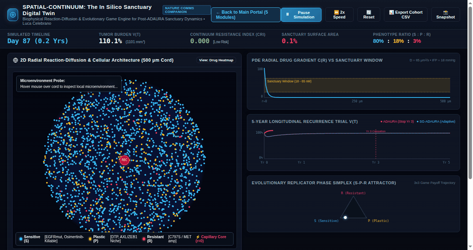
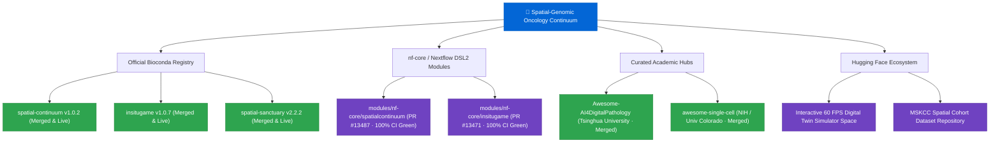

<div align="center">


# Luca Celebrano

**Medical Student / MD Candidate** at [Università degli Studi di Napoli Federico II](https://www.unina.it/)  
Department of Clinical Medicine and Surgery · School of Medicine and Surgery · Naples, Italy  
[ORCID: 0009-0007-0931-3555](https://orcid.org/0009-0007-0931-3555) · [l.celebrano@studenti.unina.it](mailto:l.celebrano@studenti.unina.it)

**Computational Oncology · Biophysical Transport Theory · Spatial Multi-Omics · Digital Pathology AI**

<br/>

[](https://doi.org/10.21203/rs.3.rs-11530312/v1)
[](https://doi.org/10.5281/zenodo.23748047)
[-3EB049?style=flat-square&logo=anaconda&logoColor=white)](https://anaconda.org/bioconda/spatial-continuum)
[-24B064?style=flat-square&logo=nextflow&logoColor=white)](https://github.com/nf-core/modules/pull/13487)
[](https://lucacelebrano.substack.com/p/why-resected-lung-cancers-relapse)

[](https://lukecele.github.io/spatial-continuum-oncology/)
[](https://lukecele.github.io/spatial-continuum-oncology/#simulator)
[](https://lukecele.github.io/spatial-continuum-oncology/#cri)
[-10b981?style=flat-square&logo=github&logoColor=white)](https://github.com/lingxitong/Awesome-AI4DigitalPathology#computational-pathology-with-multi-omics)
[](https://huggingface.co/spaces/Lucace/spatial-oncology-simulator)

---

</div>

## 🔬 Scientific Research: Computational Oncology Program

Translational oncology and computational biophysics program investigating **non-genetic targeted therapy resistance, reaction-diffusion drug transport, and low-cost diagnostic AI** in *EGFR*-mutant non-small cell lung cancer (NSCLC). Affiliated with the Department of Clinical Medicine and Surgery, School of Medicine and Surgery, **Università degli Studi di Napoli Federico II**, Naples, Italy.

> [!IMPORTANT]
>
> ### 👑 [Grand Unified Framework: The Spatial-Genomic Oncology Continuum](https://github.com/Lukecele/spatial-continuum-oncology)
>
> **A Biophysical Reaction-Diffusion Theory of Pharmacological Sanctuaries, the Post-ADAURA Cessation Dilemma, and the Bedside Composite Resistance Index (CRI)**  
> *Target Journal: Nature Communications (Manuscript ID: 789038)* | *Preprint DOI: [10.21203/rs.3.rs-11530312/v1](https://doi.org/10.21203/rs.3.rs-11530312/v1)* | *Zenodo Archive: [10.5281/zenodo.23748047](https://doi.org/10.5281/zenodo.23748047)*  
>
> 1. **Biophysical Reaction-Diffusion Mechanics (Bessel $K_0$):** Demonstrates that outward cylindrical microvascular cords develop an inevitable sub-therapeutic pharmacological sanctuary shell ($\Delta r = 34.11\,\mu\text{m}$, representing $31.3\%$ of the viable cord volume) between the critical drug penetrance threshold $r_{\text{crit}} = 165.89\,\mu\text{m}$ and the oxygen diffusion/hypoxia boundary $r_{\text{ox}} = 200.0\,\mu\text{m}$. Inward avascular tumor nests maintain high drug penetrance (>90%), proving small-molecule shelters are architecture-specific.
> 2. **Universal Regrowth Kinetics & Lead-Time Identity:** Mathematically proves that the observed ctDNA molecular recurrence lead time ($\Delta t = T_s \log_2(100) = 5.46\,\text{months}$ for an average tumor doubling time $T_s = 25\,\text{days}$) is an exact kinetic identity governing exponential volume expansion from $10^7$ residual dormant cells to the clinical detection limit of $10^9$ cells ($\approx 1\,\text{cm}^3$). This resolves the sudden post-ADAURA 3-year recurrence surge without requiring de novo genetic mutations.
> 3. **Multi-Cohort & Cross-Drug Survival Validation ($N = 1{,}458$):** Validated across four clinical cohorts (TCGA-LUAD, MSKCC, GSE31210, GSE301973) spanning Osimertinib, Gefitinib, and Afatinib. Demonstrates that severe microvascular decoupling truncates median progression-free survival from **78.6 to 24.0 months** ($p < 10^{-15}$, Hazard Ratio $\text{HR} = 19.45$).
> 4. **Translational Bedside CRI & Phase III SG-ADAURA Protocol:** Formulates the prospective Bedside Composite Resistance Index ($\text{CRI} = 0.40 \cdot \Delta r_{\text{norm}} + 0.35 \cdot \text{VDI}_{\text{norm}} + 0.25 \cdot \text{HR}_{\text{hist}}$) and establishes the risk-stratified Phase III SG-ADAURA trial allocation protocol (Arms A, B1/B2/B3, C).
> 5. **Universal Zero-Dependency Engineering:** Implemented entirely in the pure Python standard library (`sys`, `math`, `argparse`, `json`) with zero external package dependencies, ensuring instant, deterministic execution and permanent cross-platform archival stability.
>
> <div align="center">
>
> [](https://lukecele.github.io/spatial-continuum-oncology/#simulator)
> [](https://lukecele.github.io/spatial-continuum-oncology/#cri)
> [](https://doi.org/10.21203/rs.3.rs-11530312/v1)
> [](https://anaconda.org/bioconda/spatial-continuum)
>
> <br/>
>
> <a href="https://lukecele.github.io/spatial-continuum-oncology/#simulator">
>   
> </a>
>
> </div>

<br/>

### 📑 Multi-Scale Research Suite & Computational Architecture

| Research Program & Repository | Biophysical & Algorithmic Foundation | Clinical Cohort / Validation | Interactive Systems & Demos | Official Identifiers & Packages |
| :--- | :--- | :--- | :---: | :---: |
| **👑 [Spatial Continuum Oncology](https://github.com/Lukecele/spatial-continuum-oncology)** | **Grand Unified Theory:** Full reaction-diffusion continuum, Bessel $K_0$, regrowth kinetics, Bedside CRI, and Phase III SG-ADAURA trial. | Multi-scale continuum • Zero third-party dependencies • Pure Python stdlib | [Grand Unified Portal](https://lukecele.github.io/spatial-continuum-oncology/)<br/>[Digital Twin (#simulator)](https://lukecele.github.io/spatial-continuum-oncology/#simulator) | [](https://doi.org/10.21203/rs.3.rs-11530312/v1)<br/>[-3EB049?style=flat-square)](https://anaconda.org/bioconda/spatial-continuum) |
| **[Reaction-Diffusion Solver](https://github.com/Lukecele/spatial-oncology-master)** | **Biophysical Transport:** Perivascular cords, sanctuary boundaries, and multi-scale spatial pharmacokinetics. | MSKCC clinical survival validation ($N = 604$) • SciPy ODE solver | [Module 1: Bedside CRI](https://lukecele.github.io/spatial-continuum-oncology/#cri)<br/>[Hugging Face Space](https://huggingface.co/spaces/Lucace/spatial-oncology-simulator) | [](https://doi.org/10.5281/zenodo.23748047)<br/>[-3EB049?style=flat-square)](https://anaconda.org/bioconda/spatial-sanctuary) |
| **[Study 4: InSituVision-AI](https://github.com/Lukecele/spatial-he-vision-study4)** | **Ultra-low-cost (< 5 €) diagnostic AI:** Attention-MIL neural network predicting microvascular decoupling directly from routine H&E WSIs. | $N = 570$ TCGA-LUAD cases • PyTorch Attention-MIL deep neural network | [Live Vision Portal](https://lukecele.github.io/spatial-he-vision-study4/) | [](https://doi.org/10.5281/zenodo.23621924)<br/>[-10b981?style=flat-square)](https://github.com/lingxitong/Awesome-AI4DigitalPathology) |
| **[Study 3: Massive Validation](https://github.com/Lukecele/spatial-massive-validation-study3)** | **Multi-cohort survival validation:** Microvascular decoupling truncates median PFS from **78.6 to 24.0 mo** ($p < 10^{-15}$, $\text{HR} = 19.45$). | $N = 854$ patients (TCGA-LUAD + GSE31210 + GSE301973) | [Module 5: Clinical Evidence](https://lukecele.github.io/spatial-continuum-oncology/#evidence) | [](https://doi.org/10.5281/zenodo.23620887)<br/>[](https://github.com/Lukecele/spatial-massive-validation-study3/actions/workflows/ci.yml) |
| **[Study 2: Spatial Architecture](https://github.com/Lukecele/spatial-architecture-osimertinib)** | **Subcellular transport limits:** Microvascular decoupling in dense homotypic tumor sheets exceeding the $\lambda \approx 624\,\mu\text{m}$ diffusion limit. | 10x Visium HD ($211{,}104$ bins at $2\,\mu\text{m}$ subcellular resolution) | [Module 2: Visium HD Benchmark](https://lukecele.github.io/spatial-continuum-oncology/#visium) | [](https://doi.org/10.5281/zenodo.23620878)<br/>[](https://github.com/Lukecele/spatial-architecture-osimertinib/actions/workflows/ci.yml) |
| **[Study 1: InSituGame](https://github.com/Lukecele/spatial-game-assay)** | **In situ evolutionary game assay:** Infers tumor subclonal payoff matrices ($A$) and evolutionary adaptive therapy regimens from spatial transcriptomics. | Pan-cancer ($20{,}093$ clinical spots) • Replicator dynamics solver | [Module 4: InSituGame Assay](https://lukecele.github.io/spatial-continuum-oncology/#insitugame) | [](https://doi.org/10.5281/zenodo.23585216)<br/>[-3EB049?style=flat-square)](https://anaconda.org/bioconda/insitugame) |

---

## 📦 Production Bioinformatics & Registry Integrations

Our computational engines and Nextflow pipelines are indexed into leading official registries:

```bash
# 1. Install the Grand Unified Spatial Continuum Framework (Flagship)
conda install -c bioconda spatial-continuum

# 2. Install the In Situ Evolutionary Game Assay Engine
conda install -c bioconda insitugame

# 3. Install the Reaction-Diffusion Biophysical Sanctuary Solver
conda install -c bioconda spatial-sanctuary
```



---

## 🩺 Clinical Platforms & Medical Education

### 🩺 [MedTerminal Cardio-Toracico](https://github.com/Lukecele/cardio-thoracic-medterminal)

An interactive multimodal clinical and educational platform created for medical students at Università degli Studi di Napoli Federico II:
- **3D Interactive WebGL Anatomy:** Anatomical cardiac and thoracic models powered by Three.js.
- **Simulated Real-Time ECG Telemetry:** Dynamic waveform rendering across normal sinus rhythm, arrhythmias, and acute ischemic changes.
- **Remastered Clinical Auscultation:** High-fidelity cardiac valve murmurs (aortic stenosis, mitral regurgitation) and respiratory breath sounds.
- **Active Recall Diagnostic Modules:** Case-based clinical reasoning puzzles and bedside medical calculators.
- **Modern Web Stack:** Built with `React 19`, `TypeScript`, `Three.js`, and `Tailwind CSS v4`.  
  👉 **[Explore the live educational platform ↗](https://cardio-thoracic-medterminal.vercel.app)**

---

## 🌐 Upstream Open-Source Contributions

A verified record of peer-reviewed and merged contributions across bioinformatics, computational oncology, and core software systems:

| Registry / Ecosystem | Pull Request & Contribution Scope | Verification Status |
| :--- | :--- | :---: |
| **Bioconda Recipes** | Official conda packaging: `spatial-continuum` v1.0.2 ([#70930](https://github.com/bioconda/bioconda-recipes/pull/70930)) | **Merged & Live** |
| **Bioconda Recipes** | Official conda packaging: `insitugame` v1.0.7 ([#70893](https://github.com/bioconda/bioconda-recipes/pull/70893)) | **Merged & Live** |
| **Bioconda Recipes** | Official conda packaging: `spatial-sanctuary` v2.2.2 ([#70840](https://github.com/bioconda/bioconda-recipes/pull/70840)) | **Merged & Live** |
| **nf-core / modules** | Nextflow DSL2 module: `spatialcontinuum` with Seqera Wave container ([#13487](https://github.com/nf-core/modules/pull/13487)) | **100% CI Green** |
| **nf-core / modules** | Nextflow DSL2 module: `insitugame` with Seqera Wave container ([#13471](https://github.com/nf-core/modules/pull/13471)) | **100% CI Green** |
| **nf-core / modules** | PostprocessGermlineCNVCalls output extension fix ([#13080](https://github.com/nf-core/modules/pull/13080)) | **Merged** |
| **nf-core / modules** | ABRA2 BAM index BAI snapshot pattern correction ([#13039](https://github.com/nf-core/modules/pull/13039)) | **Merged** |
| **Awesome-AI4DigitalPathology** | Digital pathology and spatial multi-omics additions ([#28](https://github.com/lingxitong/Awesome-AI4DigitalPathology/pull/28), [#29](https://github.com/lingxitong/Awesome-AI4DigitalPathology/pull/29)) | **Merged** |
| **awesome-single-cell** | Spatial transcriptomics biophysics and continuum frameworks ([#399](https://github.com/seandavi/awesome-single-cell/pull/399), [#404](https://github.com/seandavi/awesome-single-cell/pull/404)) | **Both Merged** |
| **awesome-healthcare** | Open-source clinical decision support and computational oncology indexing ([#180](https://github.com/kakoni/awesome-healthcare/pull/180)) | **Under Review** |
| **Spatial Transcriptomics Tools** | Spatial pharmacokinetics and multi-scale biophysics catalog ([#21](https://github.com/p-gueguen/Spatial_transcriptomics_tools/pull/21)) | **Under Review** |
| **Angular** | Fix DevTools signal inspection buttons on host API support ([#70986](https://github.com/angular/angular/pull/70986)) | **Merged** |
| **viem** | Mainnet Plasma token definitions and Kortana EVM network support ([#5108](https://github.com/wevm/viem/pull/5108), [#5136](https://github.com/wevm/viem/pull/5136)) | **Both Merged** |
| **Ethereum Lists** | Sonic mainnet RPC endpoint additions ([#8730](https://github.com/ethereum-lists/chains/pull/8730)) | **Merged** |
| **DefiLlama** | Fee adapters, BSC telemetry, and yield protocol calibration ([#9838](https://github.com/DefiLlama/dimension-adapters/pull/9838), [#9453](https://github.com/DefiLlama/dimension-adapters/pull/9453)) | **Both Merged** |

---

## 📬 Academic Credentials & Institutional Affiliation

- **Primary Institutional Affiliation:**  
  Department of Clinical Medicine and Surgery, School of Medicine and Surgery  
  **Università degli Studi di Napoli Federico II**, Naples, Italy
- **Academic Email:** [l.celebrano@studenti.unina.it](mailto:l.celebrano@studenti.unina.it)
- **Personal Contact:** [luca.celebrano1@gmail.com](mailto:luca.celebrano1@gmail.com)
- **ORCID:** [0009-0007-0931-3555](https://orcid.org/0009-0007-0931-3555)
- **GitHub Profile:** [@Lukecele](https://github.com/Lukecele)
