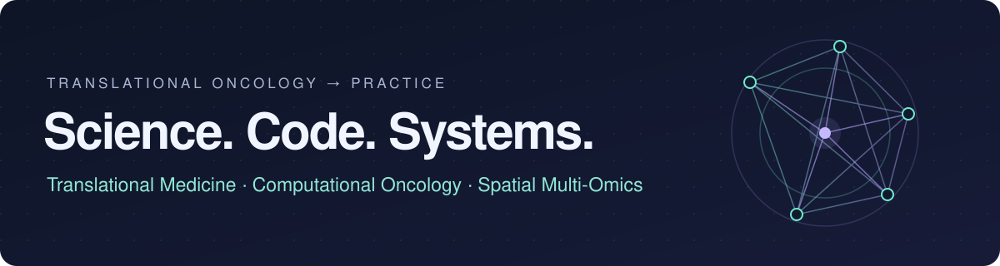

# Luca Celebrano

**Medical Student** at [Università degli Studi di Napoli Federico II](https://www.unina.it/) · **Bioinformatics Thesis** at [TIGEM](https://www.tigem.it/)  
Naples, Italy · [ORCID: 0009-0007-0931-3555](https://orcid.org/0009-0007-0931-3555) · [l.celebrano@studenti.unina.it](mailto:l.celebrano@studenti.unina.it)

**Computational Oncology · Spatial Biology & Biophysics · AI in Digital Pathology**

[-007acc.svg)](https://www.springer.com/journal/285)

---

## 🔬 Scientific Research: Spatial Oncology Tetralogy

Independent research program investigating **non-genetic targeted therapy resistance, subcellular biophysical transport, and low-cost diagnostic AI** in *EGFR*-mutant lung adenocarcinoma (NSCLC). Affiliated with the Department of Clinical Medicine and Surgery, **Università degli Studi di Napoli Federico II**, and bioinformatics experimental thesis at **TIGEM** (Telethon Institute of Genetics and Medicine).

> [!IMPORTANT]
> ### 👑 [Master Study: Spatial Oncology & Biophysical Sanctuary Dynamics](https://github.com/Lukecele/spatial-oncology-master)
> **End-to-End Multi-Scale Causal Continuum:**  
> 1. **Biophysical Transport:** Exact modified Bessel order-zero ($K_0$) decay ($\lambda = 627.7\,\mu\text{m}$, $r_{\text{crit}} = 165.9\,\mu\text{m}$, viable sanctuary shell $\Delta r = 34.1\,\mu\text{m}$ at $\theta = 0.35$).  
> 2. **Evolutionary Game Theory:** Frequency-dependent replicator dynamics proving asymptotic Lyapunov stability of DTP coexistence ($x^* = 0.6133$, $\lambda_{\text{eig}} = -1.7934 < 0$) with calibrated post-ADAURA cessation regrowth (ctDNA detection at 10.7 mo, CT relapse at 16.1 mo, lead time 5.4 mo).  
> 3. **Clinical Cohort Validation:** MSKCC 2020 cohort ($N = 604$), demonstrating an extreme biophysical contrast of $HR = 6.75$ ($p = 5.52 \times 10^{-4}$) between solid/micropapillary architecture and lepidic baseline ($N=193$).  
> 4. **Routine Diagnostic AI:** Attention-MIL neural network predicting microvascular decoupling and osimertinib PFS directly from routine H&E whole-slide images ($< 5\text{ €}$, $-99.91\%$ cost reduction).  
> 
>   

| Study | Focus & Novelty | Cohort / Method | Portal | DOI (Zenodo) | Status |
| :--- | :--- | :--- | :---: | :---: | :---: |
| **👑 [Master Study](https://github.com/Lukecele/spatial-oncology-master)** | **Unified Causal Continuum:** Biophysics ($K_0$), Replicator Game Dynamics, MSKCC Validation, and H&E AI (< 5 €). | Multi-scale continuum • Colab Notebook | [**Live Demo ↗**](https://lukecele.github.io/spatial-oncology-master/) |  | `Submitted (JOMB)` `bioRxiv (Screening)` |
| **[Study 4: InSituVision-AI](https://github.com/Lukecele/spatial-he-vision-study4)** | **Zero-cost (< 5 €) diagnostic AI:** Attention-MIL neural network predicting microvascular decoupling and osimertinib PFS directly from routine H&E. | $N = 570$ TCGA-LUAD cases • Colab T4 | [**Live Demo ↗**](https://lukecele.github.io/spatial-he-vision-study4/) |  |  |
| **[Study 3: Massive Validation](https://github.com/Lukecele/spatial-massive-validation-study3)** | **Multi-cohort clinical survival validation:** Microvascular decoupling truncates median PFS from **78.6 to 24.0 mo** ($p < 10^{-15}$, $HR = 19.45$). | $N = 854$ patients (TCGA + GSE31210) | [**Live Demo ↗**](https://lukecele.github.io/spatial-massive-validation-study3/) |  |  |
| **[Study 2: Spatial Architecture](https://github.com/Lukecele/spatial-architecture-osimertinib)** | **Subcellular biophysical transport:** Microvascular decoupling in dense homotypic tumor sheets exceeding the $\lambda \approx 624\,\mu\text{m}$ diffusion limit. | 10x Visium HD ($211,104$ bins at $2\,\mu\text{m}$) | [**Live Demo ↗**](https://lukecele.github.io/spatial-architecture-osimertinib/) |  |  |
| **[Study 1: InSituGame](https://github.com/Lukecele/spatial-game-assay)** | **In situ evolutionary game assay:** Infers subclonal payoff matrices ($A$) and Nash equilibria from intact spatial transcriptomics. | Pan-cancer ($20,093$ clinical spots) | [**Live Demo ↗**](https://lukecele.github.io/spatial-game-assay/) |  | `Submitted (AACR CRC)` `bioRxiv (761331)` |

---

## 🩺 Medical Platforms & Software Engineering

### 🩺 [MedTerminal Cardio-Toracico](https://github.com/Lukecele/cardio-thoracic-medterminal)
Interactive multimodal educational platform for medical students at Università degli Studi di Napoli Federico II: 3D WebGL cardiac/thoracic anatomy (Three.js), simulated ECG telemetry, remastered heart & lung auscultation audio, active recall quizzes, and clinical calculators.  
`React 19` · `TypeScript` · `Three.js` · `Tailwind v4` · **[Explore live platform ↗](https://cardio-thoracic-medterminal.vercel.app)**

### 📱 [ARBVPN](https://github.com/Lukecele/ARBVPN) & Creative Web PWAs
- **[ARBVPN](https://github.com/Lukecele/ARBVPN):** Cross-platform 1-tap WireGuard VPN mobile application built with React Native, Expo, and TypeScript.
- **Interactive PWAs & Web Showcases:** High-performance responsive web applications exploring Web Audio API, animation, and cultural archives ([Vegeta](https://github.com/Lukecele/vegeta-site), [Sanctuary Music](https://github.com/Lukecele/music-site), [Sylvester Stallone](https://github.com/Lukecele/stallone-site), [Silvio Berlusconi](https://github.com/Lukecele/berlusconi-site)).

### ⚡ Arbitrage Inception ([@arbincept](https://github.com/arbincept))
Founder & maintainer of [**Arbitrage Inception**](https://github.com/arbincept), an independent open-source organization dedicated to on-chain telemetry, DEX aggregation, and quantitative algorithmic systems (including *Arb-Inc All-in-Dex*, *Inception Flap Scanner*, and *Virtue*).

---

## 🌐 Merged Open-Source Contributions

Upstream contributions to core developer ecosystems and biomedical software:

| Ecosystem | Pull Request & Contribution |
| :--- | :--- |
| **nf-core / modules** | GATK4 PostprocessGermlineCNVCalls output extension fix & ABRA2 BAI snapshot fix — [#13080](https://github.com/nf-core/modules/pull/13080), [#13039](https://github.com/nf-core/modules/pull/13039) |
| **Angular** | Gate DevTools signal watch controls on host API support — [#70986](https://github.com/angular/angular/pull/70986) |
| **viem** | Plasma USDC/EURC token addresses and Kortana chain support — [#5108](https://github.com/wevm/viem/pull/5108), [#5136](https://github.com/wevm/viem/pull/5136) |
| **Ethereum Lists** | Sonic RPC endpoint network additions — [#8730](https://github.com/ethereum-lists/chains/pull/8730) |
| **DefiLlama** | Fee adapters, BSC tax accounting & yield metrics — [#9838](https://github.com/DefiLlama/dimension-adapters/pull/9838), [#9453](https://github.com/DefiLlama/dimension-adapters/pull/9453) |

---

## 📬 Contact & Affiliations

- **Academic Email:** [l.celebrano@studenti.unina.it](mailto:l.celebrano@studenti.unina.it)
- **Personal Email:** [luca.celebrano1@gmail.com](mailto:luca.celebrano1@gmail.com)
- **ORCID:** [0009-0007-0931-3555](https://orcid.org/0009-0007-0931-3555)
- **Affiliations:** Università degli Studi di Napoli Federico II · TIGEM (Telethon Institute of Genetics and Medicine) · Naples, Italy
